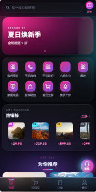
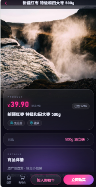
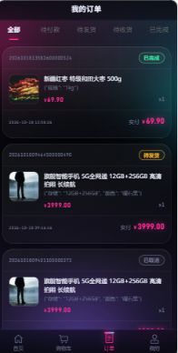
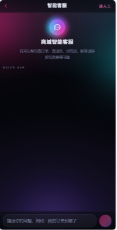
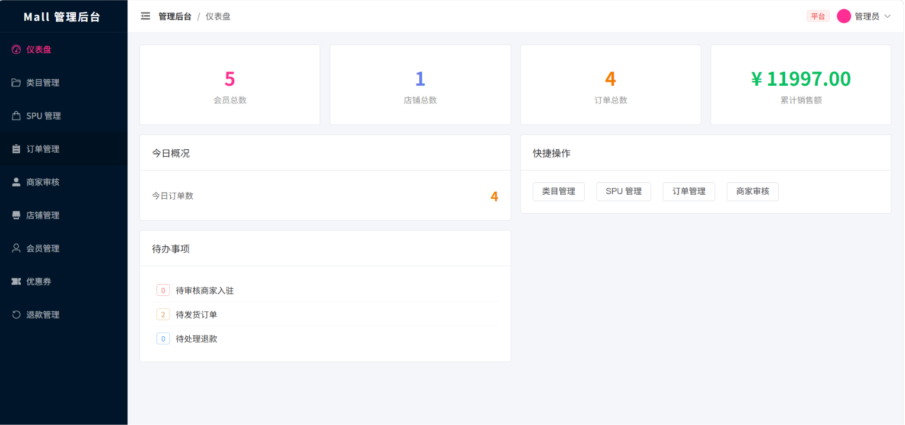
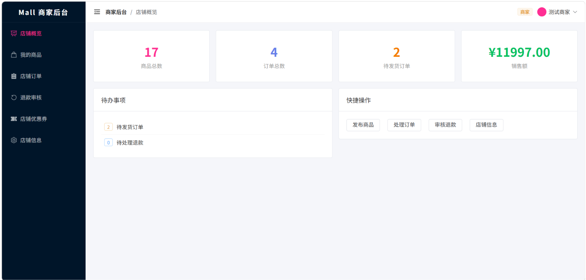

<div align="center">
  <h1>🛒 Mall</h1>
  <p><strong>单体可商用商城系统 · 全栈交易闭环</strong></p>
  <p>
    
    
    
    
    
    
    
  </p>
</div>

---

## 📋 项目简介

一套完整的 **单体架构** 电商系统，覆盖 **C 端移动端 H5 + B 端商家后台 + 平台后台**，交付从注册到收货的完整交易闭环，并内置 **基于 Spring AI 的智能客服 Agent**。

设计目标：用最简单的架构实现可商用的交易能力，**不引入微服务组件**（无 Nacos / Gateway / RocketMQ / Seata / K8s），**一条 `docker compose up -d --build` 即可启动全栈**。

### 核心流程

```
注册/登录 → 浏览商品 → 加入购物车 → 下单锁库存 → 沙箱支付 → 回调扣库存出库 → 商家发货 → 确认收货
```

---

## 🖼️ 界面预览

### C 端移动端 H5

| 首页 | 商品详情 | 我的订单 | 智能客服 |
|---|---|---|---|
|  |  |  |  |

### B 端管理后台

平台端与商家端共用同一入口，登录后按账号角色动态渲染菜单。

**平台端 · 仪表盘**



**商家端 · 店铺概览**



---

## ✨ 功能概览

| 端 | 入口 | 主要能力 |
|---|---|---|
| **移动端 H5** | http://localhost:3002 | 首页 / 分类 / 商品详情 / 购物车 / 下单结算 / 优惠券领取 / 支付 / 订单列表详情 / 退款申请与列表 / 收货地址 / 个人中心 / **智能客服** |
| **管理后台** | http://localhost:3001 | 平台端与商家端共用，登录后按角色动态渲染菜单：仪表盘 / 分类 / 商品 SPU / 订单 / 退款 / 优惠券 / 会员 / 店铺 / 商家入驻审核 |
| **后端 API** | http://localhost:8088/swagger-ui.html | 28 个 Controller，按领域分包，统一返回体 `R<T>`，JWT 认证 + 角色鉴权 |

### 智能客服（Spring AI Agent）

- 后端 `POST /api/ai/chat/stream` 以 **SSE 逐字流式**返回，前端在移动端「我的 → 智能客服」使用。
- 模型由 **Spring AI `ChatClient`** 驱动，工具调用循环由框架托管，内置 5 个工具：`search_faq` / `query_order` / `query_refund` / `search_product` / `handoff_to_human`。
- **开箱可用**：未配置真实模型 Key 时自动降级为内置 `MockChatModel`（`mall.ai.mock-enabled=true`），无需任何外部服务即可体验完整问答与转人工流程；配置真实 OpenAI 兼容 Key 后即接入真实大模型。
- 用户身份与订单归属全部取自 JWT，禁止信任前端传入的身份参数。

---

## 🏗️ 技术栈

| 层级 | 技术 |
|---|---|
| **后端** | Java 21 · Spring Boot 3.4.5 · Spring AI 1.0.0 · MyBatis-Plus 3.5.9 · Spring Security + JWT (jjwt 0.12) · Flyway · Hutool · Lombok · MapStruct |
| **API 文档** | springdoc-openapi（Swagger UI；原 Knife4j 与 Boot 3.4 不兼容已移除） |
| **存储** | MySQL 8.0 · Redis 7（Lua 原子库存）· MinIO（对象存储） |
| **C 端 H5** | Vue 3 + Vite + Vant 4 + Pinia |
| **管理后台** | Vue 3 + Vite + Element Plus + Pinia |
| **部署** | Docker + Docker Compose（6 服务） |

---

## 📁 项目结构

```
mall-v1/
├── docker-compose.yml            # 全栈编排（mysql/redis/minio/backend/admin-web/mobile-h5）
├── nginx-admin.conf              # 管理后台镜像内 Nginx 配置（静态 + /api 反代）
├── nginx-mobile.conf             # 移动端镜像内 Nginx 配置（含 SSE 关闭缓冲）
│
├── backend/                      # Spring Boot 单体后端
│   ├── Dockerfile                # 多阶段构建（JDK21 构建 → JRE21 运行）
│   ├── mvnw / mvnw.cmd           # Maven Wrapper（首次构建自动下载 Maven）
│   └── src/main/java/com/mall/
│       ├── common/               # R / 异常 / 安全(JWT) / 配置 / 公共实体
│       ├── system/               # 用户体系（会员 / 商家 / 管理员 / 地址）
│       ├── product/              # 商品管理（SPU / SKU / 分类）
│       ├── cart/                 # 购物车
│       ├── order/                # 订单（状态机 + 状态日志）
│       ├── stock/                # 库存（Redis Lua + DB 条件更新双保险）
│       ├── pay/                  # 支付（沙箱渠道，幂等回调）
│       ├── marketing/            # 营销（优惠券 + 退款/售后）
│       └── ai/                   # 智能客服（Spring AI Agent）
│   └── src/main/resources/
│       ├── db/migration/         # Flyway 版本化迁移 V1 ~ V8
│       └── db/seed/              # 本地开发专用演示数据（仅 local profile 加载）
│
├── admin-web/                    # 管理后台（Element Plus）+ Dockerfile
└── mobile-h5/                    # 移动端 H5（Vant 4）+ Dockerfile
```

---

## 🚀 快速启动

### 前置要求

只需 **Docker 与 Docker Compose**（无需本机安装 JDK / Node）。构建镜像时会联网拉取 Maven 与 npm 依赖。

### 一键启动（推荐）

```bash
git clone <你的仓库地址> mall-v1
cd mall-v1

# 构建并启动全部服务（后端、前端均在容器内完成构建）
docker compose up -d --build
```

首次启动会依次完成：MySQL 建库 → Flyway 自动迁移建表并写入种子数据 → 后端启动 → 前端镜像构建。等待约 1~2 分钟后访问下表地址即可。

> 停止 / 清理：`docker compose down`（保留数据卷）或 `docker compose down -v`（连数据一起清空）。

### 访问地址

| 服务 | 地址 | 说明 |
|---|---|---|
| 移动端 H5 | http://localhost:3002 | C 端，建议用浏览器移动端模式打开 |
| 管理后台 | http://localhost:3001 | 平台端 + 商家端 |
| 后端 API 文档 | http://localhost:8088/swagger-ui.html | Swagger UI |
| 后端健康/接口 | http://localhost:8088/api/** | 前端经 Nginx 反代访问 |
| MinIO 控制台 | http://localhost:9001 | 账号 `admin` / `minioadmin` |

### 默认账号

| 角色 | 入口 | 账号 | 密码 / 登录方式 |
|---|---|---|---|
| 平台管理员 | 管理后台 | `admin` | `admin123` |
| 商家 | 管理后台（同入口，按角色渲染） | `shop` | `shop123` |
| 会员 | 移动端 H5 | 手机号 `13800000000` | 短信验证码登录（本地 mock 模式，发送接口直接回显验证码） |

> 上述账号与演示商品（12 个 SPU / 24 个 SKU / 4 张优惠券）均由 Flyway 迁移 `V3__seed_data.sql`、`V4__seed_self_shop.sql`、`V7__seed_catalog.sql` 自动写入，**克隆后无需手工导入任何数据**。

### 本地开发（不用容器跑应用）

```bash
# 1. 仅启动基础设施
docker compose up -d mysql redis minio

# 2. 后端：复制本地配置模板（已 gitignore）后启动
cd backend
cp src/main/resources/application-local.yml.example src/main/resources/application-local.yml  # 若已存在则跳过
./mvnw spring-boot:run -Dspring-boot.run.profiles=local     # Windows 用 mvnw.cmd

# 3. 管理后台
cd admin-web && npm install && npm run dev                  # → http://localhost:3001

# 4. 移动端
cd mobile-h5 && npm install && npm run dev                  # → http://localhost:3002
```

> 本地开发时 Redis 映射端口为 `6381`、MySQL 为 `3308`（`application-local.yml` 已按此配置）。前端 dev server 已配置 `/api` 代理到 `http://localhost:8080`。

---

## 🧪 测试

```bash
cd backend
./mvnw test                    # 运行全部单元测试（267 个用例）
./mvnw test -Dtest=XxxTest     # 运行单个测试类
```

测试覆盖重点：

- **下单锁库存** — Redis Lua 原子预占 + DB `available>=?` 条件更新双保险，杜绝超卖
- **支付幂等** — 第三方交易号唯一索引，重复回调直接返回成功
- **金额计算** — 全程 `BigDecimal`，无浮点误差
- **资源归属** — 买家不能操作他人订单，商家不能越权操作他人商品 / 订单

---

## ⚙️ 配置说明

仓库内只保留 **开发用占位配置**，真实密钥一律不入库（`application-local.yml` 已在 `.gitignore` 中）：

| 配置项 | 位置 | 默认行为 |
|---|---|---|
| 数据库 / Redis / MinIO 连接 | `docker-compose.yml` 环境变量 | 容器内互相按服务名访问 |
| 智能客服模型 Key | 环境变量 `MALL_AI_API_KEY`（可选） | 缺省时使用内置 Mock 模型，开箱即用 |
| 模型服务地址 / 名称 | `MALL_AI_BASE_URL` / `MALL_AI_MODEL` | 默认 `https://api.deepseek.com/v1` + `deepseek-chat` |
| 短信验证码 | `mall.sms.mock-enabled` | 本地为 `true`，发送接口回显验证码，生产必须置 `false` |

接入真实大模型：在 `docker-compose.yml` 的 `backend.environment` 中追加 `MALL_AI_API_KEY`，并把 `backend/src/main/resources/application.yml` 中 `mall.ai.mock-enabled` 改为 `false` 后重建后端镜像。

---

## 🧱 核心业务模块

### 用户体系
会员注册/登录（BCrypt + JWT 无状态认证）、短信验证码登录、商家入驻申请与平台审核、管理员 RBAC。

### 商品系统
SPU / SKU 多规格模型、分类树、多图、上下架与审核状态。

### 购物车
Redis 存储、勾选 / 改数量 / 删除、下单前库存实时校验。

### 订单系统
状态机：`05 已取消 → 10 待支付 → 20 待发货 → 30 待收货 → 40 已完成`；`confirm` 试算生成防重复令牌 → `submit` 下单（Redis Lua + DB 条件更新双保险锁库存）；每次流转记录 `oms_order_status_log`。

### 库存系统
Redis Lua 原子脚本预占库存；DB `available_stock >= ?` 条件更新做双保险；支付成功扣减冻结库存，超时关单自动释放；出库任务管理（商家发货触发）。

### 支付系统
沙箱支付渠道（可替换为支付宝/微信生产实现）；回调幂等（第三方交易号唯一索引），成功即订单 `10→20` + 扣冻结库存 + 生成出库任务。

### 营销模块
- **优惠券**：平台券 / 店铺券、满减与折扣、领取上限、下单抵扣、取消/退款原路退回，全部通过条件更新保证并发安全。
- **退款/售后**：买家申请与撤销、商家/平台审核，同意退款时在同一事务内完成原路退回 + 库存回补 + 订单状态更新。

### 智能客服
见上文「智能客服（Spring AI Agent）」。

---

## 📐 设计原则

- **金额一律 `BigDecimal`**，DB 用 `decimal(12,2)`，禁止 `float`/`double`
- **统一返回体** `R<T>{code, msg, data}`，错误码分段：1xxxx 参数 / 2xxxx 认证 / 3xxxx 业务 / 5xxxx 服务端
- **数据库变更一律走 Flyway 新迁移**，不手改已有 SQL
- **写操作必须 `@Transactional`**，事务方法不吞异常
- **资源归属校验** — 每个对外写接口都校验当前用户是否有权操作该资源
- **列表接口统一分页**（`pageNum` / `pageSize`）

---

## 📊 数据库表一览

由 Flyway 迁移 `V1__init.sql` ~ `V8__ai_customer_service.sql` 创建：

| 分组 | 表 |
|---|---|
| 用户与权限 | `user_member`、`user_address`、`sys_user`、`sys_role`、`sys_permission`、`sys_user_role`、`sys_role_permission` |
| 商家 | `shop_shop`、`shop_apply` |
| 商品 | `pms_category`、`pms_spu`、`pms_sku`、`pms_spu_image`、`pms_seckill_activity` |
| 购物车与订单 | `cart_item`、`oms_order`、`oms_order_item`、`oms_order_status_log` |
| 库存 | `wms_stock`、`wms_stock_lock`、`wms_outbound_task` |
| 支付与售后 | `pay_payment`、`oms_refund` |
| 营销 | `pms_coupon`、`pms_coupon_member` |
| 智能客服 | `ai_conversation`、`ai_message`、`ai_faq`、`ai_handoff` |

---

## 📄 License

MIT License — 可自由使用、修改和商用。
